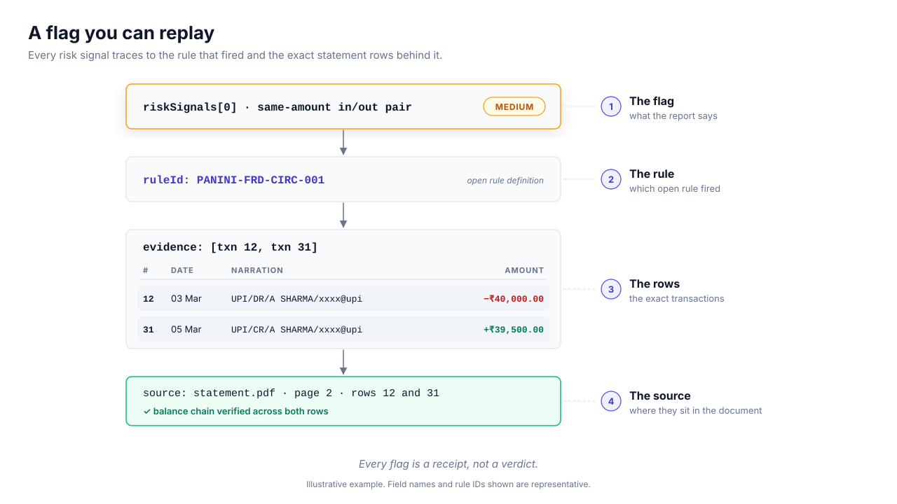

# Fraud Indicators & Multi-Account Consolidation

Panini ships a deterministic fraud-indicator suite — the same class of
named checks proprietary BSA platforms market (circular transactions,
holiday cash deposits, threshold gaming, gap months) — but every flag is
a **rule ID + evidence indices** you can audit, not a black-box score.

<picture>
  <source media="(prefers-color-scheme: dark)" srcset="assets/panini-evidence-chain-dark.svg">
  
</picture>

Entry points (`@paniniapi/insights`):

```ts
import {
  detectFraudIndicators, // one statement / pooled transaction set
  detectPortfolioIndicators, // checks that only exist across accounts
  consolidateAccounts, // multi-account rollup + internal transfer netting
  FRAUD_RULE_IDS,
} from '@paniniapi/insights';
```

Python parity: `panini.detect_fraud_indicators`,
`panini.detect_portfolio_indicators`, `panini.consolidate_accounts`.

## Per-statement indicators

| Rule ID                  | Pattern it catches                                                                                                                         |
| ------------------------ | ------------------------------------------------------------------------------------------------------------------------------------------ |
| `PANINI-FRD-CIRC-001`    | Same-amount credit→debit within days via **different** counterparties — money rotation (same-counterparty mirrors are `PANINI-RSK-RT-001`) |
| `PANINI-FRD-HOL-001`     | Cash-deposit narrations dated on weekends or supplied holidays — CDM/branch deposits don't settle on non-banking days                      |
| `PANINI-FRD-RTGS-001`    | Narrations claiming RTGS below the ₹2,00,000 RBI floor                                                                                     |
| `PANINI-FRD-ROUND-001`   | ≥40% of transactions ≥₹10,000 are exact ₹1,000 multiples (≥5 rows)                                                                         |
| `PANINI-FRD-GAP-001`     | Calendar months inside the covered span with zero transactions — dormant period or missing statement pages                                 |
| `PANINI-FRD-EQDC-001`    | Months where credits ≈ debits at meaningful volume — turnover wash                                                                         |
| `PANINI-FRD-SALSTOP-001` | Regular salary credits stop before the statement ends                                                                                      |
| `PANINI-FRD-LSAL-001`    | Debit(s) ≥80% of salary within 3 days of each salary credit                                                                                |
| `PANINI-FRD-DORM-001`    | ≥45-day lull followed by a credit ≥3× median credit                                                                                        |
| `PANINI-FRD-OD-001`      | Negative running-balance rows — overdrawn days                                                                                             |
| `PANINI-FRD-MINB-001`    | Repeated minimum-balance/penalty charges — conduct signal                                                                                  |

## Portfolio-level indicators

These only exist across a borrower's full account set — the reason
`consolidateAccounts` exists:

| Rule ID                   | Pattern                                                                |
| ------------------------- | ---------------------------------------------------------------------- |
| `PANINI-FRD-ACIRC-001`    | Money rotated `A→B→A` — cross-account cycle returned to origin         |
| `PANINI-FRD-SELFINFL-001` | ≥30% of raw credit volume is own-account transfers — turnover inflated |

`consolidateAccounts` also surfaces **cross-statement duplicates**
(same refNo + amount + direction within a day — overlapping uploads) and
produces **external-only flow totals** with internal transfer legs netted
out — the number an underwriter should actually read.

## CLI

```bash
panini-bsa acct-a.pdf acct-b.pdf            # fraud + portfolio sections in report
panini-bsa --fail-on-fraud acct-a.pdf       # exit 5 on any HIGH-severity indicator
panini-bsa --no-fraud acct-a.pdf            # skip the suite
```

Exit codes: `4` fabrication evidence (AA reconcile), `3` tamper evidence,
`5` high-severity fraud (with `--fail-on-fraud`), `2` no transactions.

## Money-flow & conduct layer

Two sibling kernels round out the credit-file picture:

```ts
import { counterpartyFlows, detectConductMetrics } from '@paniniapi/insights';
```

- **`counterpartyFlows(txns, { top })`** — per-counterparty
  inflow/outflow/net totals, txn counts, first/last seen, evidence
  indices; sorted by volume. Rows with no resolvable counterparty are
  counted in `unattributedCount` rather than silently dropped — the
  deterministic kernel behind "money trail" views.
- **`detectConductMetrics(txns)`** — behavioural conduct: overdrawn
  EOD days, worst overdraft, average EOD balance, EOD volatility %,
  bounce rate vs debits, return-fee count. Emits conduct signals
  (≥5 overdrawn days, bounce rate ≥5%, volatility ≥80%) alongside
  the metrics.

The `panini-bsa` report renders these as "Account Conduct" and "Top
Counterparties" sections automatically.

## Configuration

`FraudOptions` — `holidays` (ISO dates; weekends always count),
`circularWindowDays`, `amountTolerance`, `roundAmountMinPaise`,
`roundShareThreshold`, `dormantGapDays`, `salaryStripFraction`,
`washTolerance`. Threshold defaults are documented and conservative —
calibrate per borrower segment, never silently.

## Honest boundary

Indicators are **anomaly patterns for human review**, not fraud proof —
a legitimate business can have round figures or weekend cash deposits.
What Panini guarantees is determinism and evidence: same input → same
flags, and every flag names the exact transaction rows behind it.
